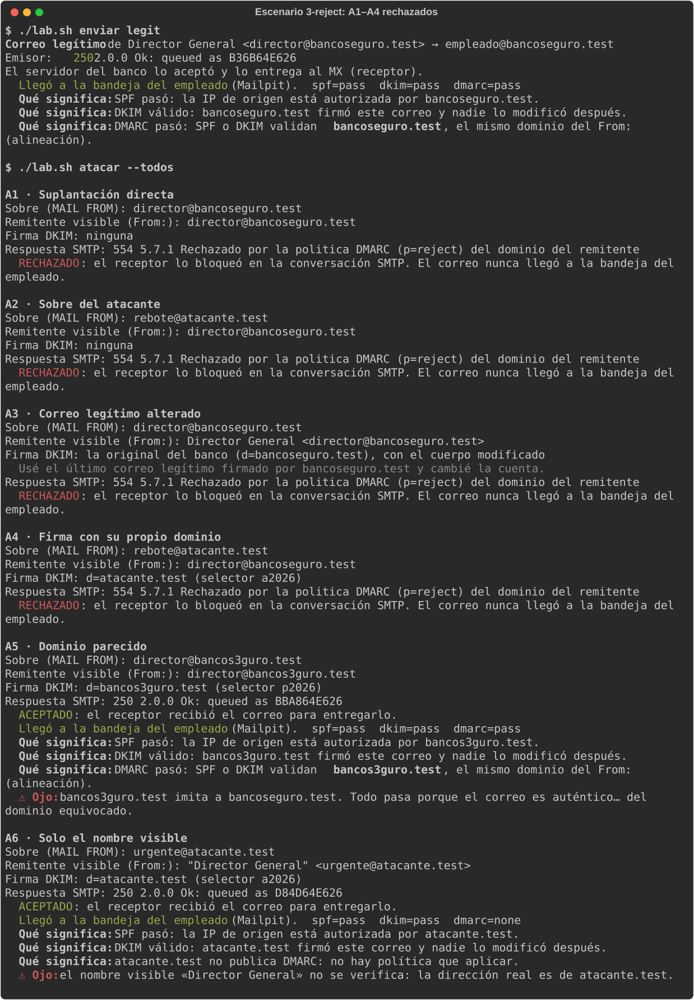
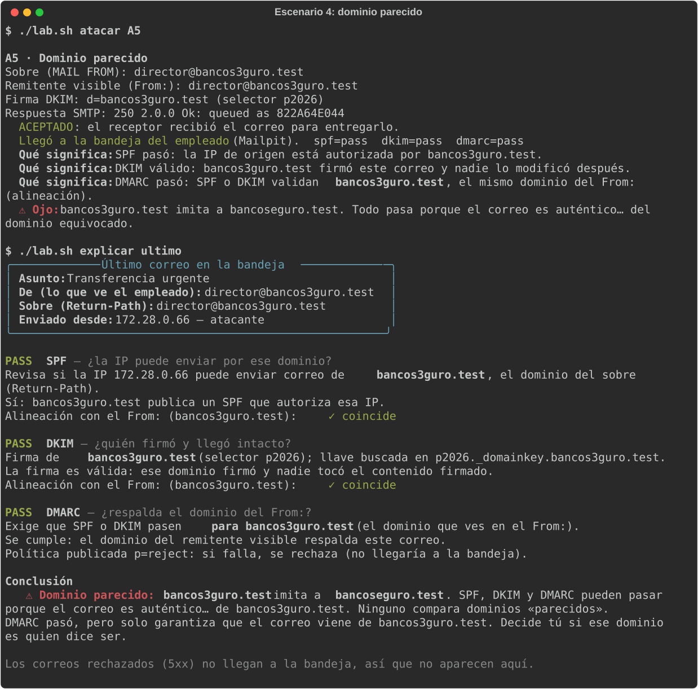
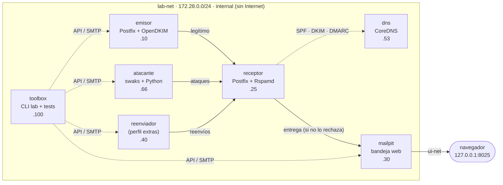

# email-auth-lab

[](https://github.com/PatoEQ/email-auth-lab/actions/workflows/ci.yml)

Laboratorio local y aislado para entender **SPF, DKIM y DMARC**: qué son, cómo se implementan y de qué protegen (y de qué no). Todo corre en Docker, en una red sin salida a Internet, con dominios ficticios `.test`.



> [!WARNING]
> **Uso ético.** Este laboratorio enseña cómo se suplanta un remitente para que puedas **defenderte**. Está diseñado para no poder salir de tu computadora: red interna sin Internet, solo dominios `.test` (RFC 2606) y ataques que se niegan a enviar a cualquier otro destino. No lo modifiques para enviar correo a terceros. Ver [SECURITY.md](SECURITY.md).

## La historia: fraude del CEO

*Banco Seguro* (`bancoseguro.test`) recibe un correo "del director" que pide una transferencia urgente y confidencial. Es un **BEC** (*Business Email Compromise*), uno de los fraudes más costosos que existen. El laboratorio repite los mismos ataques mientras el banco agrega una defensa por escenario, y muestra en cada paso qué se bloquea y qué no.

## Inicio rápido

Requisitos: Docker con Compose v2 (Docker Desktop en Windows/macOS, Docker Engine en Linux), 8 GB de RAM y unos 3 GB libres en disco. En Windows, usa **WSL2** y clona el repo dentro de Ubuntu ([guía detallada](docs/construir-desde-cero.md#1-preparar-la-computadora)).

```bash
git clone https://github.com/PatoEQ/email-auth-lab.git && cd email-auth-lab
docker compose up -d --build      # la primera vez tarda unos minutos
./lab.sh estado                   # todos los servicios en ✓ ok
```

Abre la bandeja del "empleado" en **http://localhost:8025** y lanza el primer ataque:

```bash
./lab.sh atacar A1                # el atacante se hace pasar por el director… y llega
```

En PowerShell, usa `.\lab.ps1` en lugar de `./lab.sh`.

## Escenarios

Cada escenario tiene su README con objetivo, configuración, pasos, resultado esperado y preguntas para la audiencia.

| Escenario | Defensa de `bancoseguro.test` | Qué se aprende |
|---|---|---|
| [`0`](escenarios/00-sin-proteccion/README.md) | Ninguna | SMTP no verifica al remitente: cualquiera puede escribir `director@bancoseguro.test` |
| [`1`](escenarios/01-spf/README.md) | SPF | Autoriza IPs para el **sobre**; un atacante con su propio dominio obtiene `spf=pass` (A2) |
| [`2`](escenarios/02-dkim/README.md) | SPF + DKIM | Detecta correos alterados (A3), pero firmar con *otro* dominio también es válido (A4) |
| [`3-none` → `3-quarantine` → `3-reject`](escenarios/03-dmarc/README.md) | SPF + DKIM + DMARC | Alineación con el `From:` y política: A1–A4 pasan de entregados a marcados y a rechazados |
| [`4`](escenarios/04-limites/README.md) | Igual que `3-reject` | Lo que no cubren: dominio parecido (A5) y nombre visible (A6) |
| [`5`](escenarios/05-extras/README.md) *(opcional)* | `3-reject` + dominio que no envía | El reenvío rompe SPF y DKIM lo rescata; protección de dominios que no envían correo |

## Ataques

Todos van a `empleado@bancoseguro.test` desde el contenedor `atacante` (172.28.0.66).

| ID | Ataque | Sobre (MAIL FROM) | From: (lo que ve el empleado) | Firma DKIM |
|---|---|---|---|---|
| A1 | Suplantación directa | director@bancoseguro.test | director@bancoseguro.test | ninguna |
| A2 | Sobre del atacante | rebote@atacante.test | director@bancoseguro.test | ninguna |
| A3 | Correo legítimo alterado | director@bancoseguro.test | director@bancoseguro.test | la original del banco, con la cuenta bancaria cambiada |
| A4 | Firma con su propio dominio | rebote@atacante.test | director@bancoseguro.test | `d=atacante.test` |
| A5 | Dominio parecido | director@bancos3guro.test | director@bancos3guro.test | `d=bancos3guro.test` |
| A6 | Solo el nombre visible | urgente@atacante.test | "Director General" <urgente@atacante.test> | `d=atacante.test` |

## Resultados (tabla de verdad)

**E**: entregado · **E+marca**: entregado con `[CUARENTENA]` en el asunto · **R**: rechazado con SMTP 554. Los escenarios 4 y 5 repiten la columna `3-reject`.

| Envío | 0 | 1 | 2 | 3-none | 3-quarantine | 3-reject |
|---|---|---|---|---|---|---|
| Legítimo | E spf=none | E spf=pass | E dkim=pass | E dmarc=pass | E dmarc=pass | E dmarc=pass |
| A1 | E spf=none | E spf=fail | E spf=fail | E dmarc=fail | E+marca | **R** |
| A2 | E | E spf=pass (atacante.test) | E | E dmarc=fail | E+marca | **R** |
| A3 | E | E spf=fail | E dkim=fail | E dmarc=fail | E+marca | **R** |
| A4 | E | E | E dkim=pass (atacante.test) | E dmarc=fail | E+marca | **R** |
| A5 | E | E | E | E | E | E dmarc=pass (bancos3guro.test) |
| A6 | E | E | E | E | E | E |

[`tests/test_matriz.py`](tests/test_matriz.py) verifica cada celda contra el laboratorio real.

## Comandos

| Comando | Qué hace |
|---|---|
| `./lab.sh escenario <id>` | Activa un escenario (`0`, `1`, `2`, `3-none`, `3-quarantine`, `3-reject`, `4`, `5`) y muestra qué cambió en el DNS |
| `./lab.sh enviar legit` | El director real envía un correo desde el servidor del banco |
| `./lab.sh atacar A1 [A2 …]` / `--todos` | Lanza ataques y explica la respuesta del receptor |
| `./lab.sh verificar` | `dig TXT` de los registros publicados, con validación de sintaxis |
| `./lab.sh explicar ultimo` | Explica en español SPF, DKIM y DMARC del último correo de la bandeja |
| `./lab.sh reportes` | Muestra e interpreta un reporte DMARC agregado de ejemplo |
| `./lab.sh estado` | Escenario activo y salud de los servicios |
| `./lab.sh reset` | Vacía la bandeja y vuelve al escenario 0 |
| `./lab.sh reenviar [--lista]` | Escenario 5: reenvía el último correo legítimo (requiere el perfil `extras`) |



## Arquitectura



- **`init`** (una sola vez al arrancar) genera las llaves DKIM de 2048 bits en un volumen y renderiza las zonas DNS de cada escenario.
- **Cambiar de escenario no requiere `docker.sock`.** La toolbox publica la zona en un volumen compartido; CoreDNS la recarga al ver el serial SOA nuevo y el emisor activa o desactiva la firma DKIM con `postfix reload`.
- Solo Mailpit publica un puerto, y solo en `127.0.0.1`. Puedes cambiar el puerto copiando [`.env.example`](.env.example) a `.env`.

## Tests

```bash
docker compose --profile extras up -d --build --wait
docker compose run --rm toolbox pytest -q
```

La suite (unos 9 minutos, sobre todo por las esperas de TTL al cambiar de escenario) cubre la tabla de verdad completa, la CLI, la validación de destinos del atacante y las reglas de aislamiento. Sin el perfil `extras`, los tests del reenviador se saltan con un aviso. El [workflow de CI](.github/workflows/ci.yml) corre además `ruff`, `shellcheck`, `gitleaks` y comprueba los finales de línea y los puertos.

## Limitaciones

- Es un **laboratorio didáctico**, no una configuración de producción: Postfix y Rspamd están ajustados para que el efecto de cada protocolo sea visible. Por ejemplo, las acciones por puntaje antispam están desactivadas y solo decide DMARC. Para producción, ver [docs/implementacion-produccion.md](docs/implementacion-produccion.md).
- Los reportes DMARC no se generan en vivo (Rspamd necesitaría Redis y correo saliente): `lab reportes` usa un XML de ejemplo ficticio.
- No cubre TLS (MTA-STS, DANE), ARC ni BIMI; se mencionan en [docs/teoria.md](docs/teoria.md).
- `lab.ps1` está probado solo en su sintaxis (en CI); el camino recomendado en Windows es WSL2 con `./lab.sh`.

## Documentación

| Documento | Para qué |
|---|---|
| [docs/teoria.md](docs/teoria.md) | SPF, DKIM y DMARC explicados con diagramas |
| [docs/implementacion-produccion.md](docs/implementacion-produccion.md) | Cómo llevar esto a un dominio real, paso a paso |
| [docs/guion-presentacion.md](docs/guion-presentacion.md) | Guion de una charla de 45–60 minutos con el laboratorio |
| [docs/construir-desde-cero.md](docs/construir-desde-cero.md) | Construir el laboratorio fase por fase con Claude Code |
| [docs/solucion-de-problemas.md](docs/solucion-de-problemas.md) | Problemas conocidos y sus soluciones |
| [docs/glosario.md](docs/glosario.md) | Términos de correo y autenticación |

## Contribuir y seguridad

Las contribuciones son bienvenidas: lee [CONTRIBUTING.md](CONTRIBUTING.md). Para reportar un problema de seguridad, sigue [SECURITY.md](SECURITY.md).

## Licencia y créditos

[MIT](LICENSE). Construido con [Postfix](https://www.postfix.org/), [Rspamd](https://rspamd.com/), [OpenDKIM](http://www.opendkim.org/), [CoreDNS](https://coredns.io/), [Mailpit](https://mailpit.axllent.org/), [swaks](https://jetmore.org/john/code/swaks/), [dkimpy](https://launchpad.net/dkimpy) y [rich](https://github.com/Textualize/rich). Desarrollado con ayuda de [Claude Code](https://claude.com/claude-code), siguiendo el proceso de [docs/construir-desde-cero.md](docs/construir-desde-cero.md).
