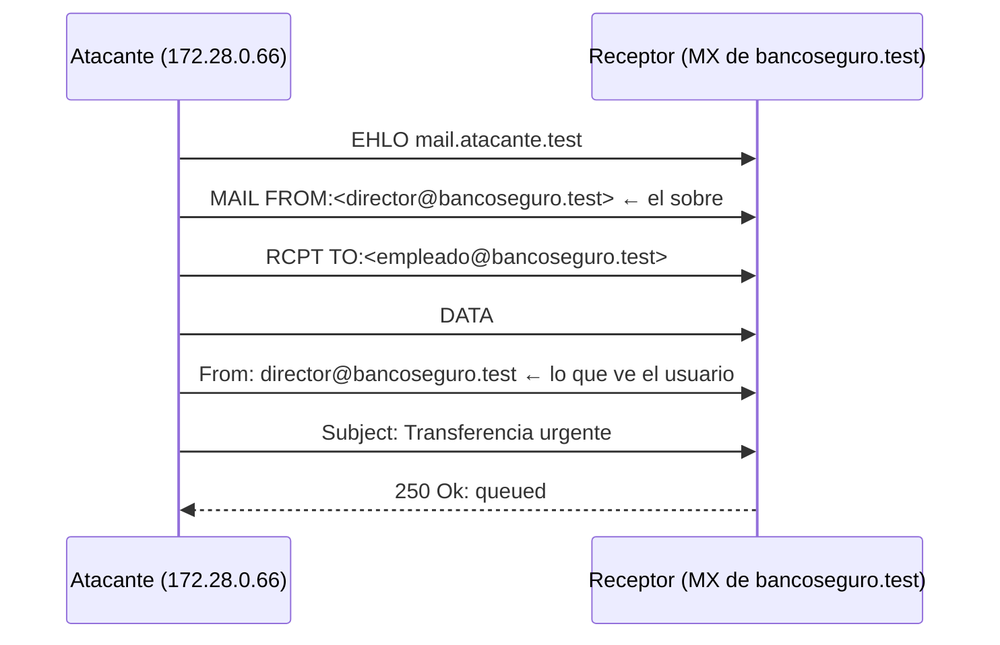
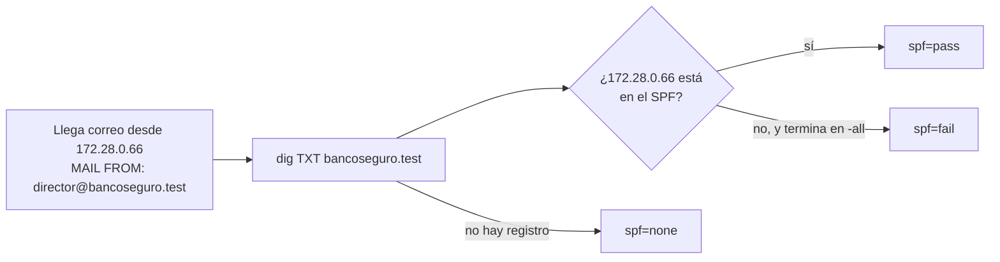
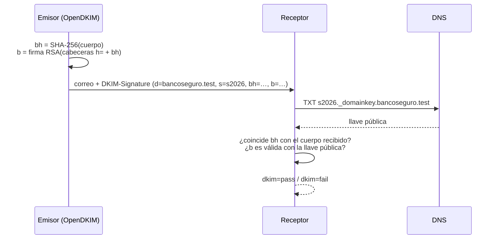
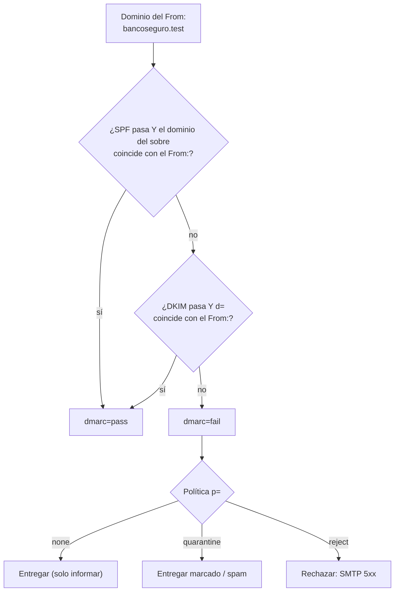

# Teoría: SPF, DKIM y DMARC

Esta guía explica los tres protocolos con los mismos ejemplos del laboratorio. Para verlos funcionar, sigue los [escenarios](../README.md#escenarios).

## 1. El problema: SMTP no verifica al remitente

SMTP, el protocolo que transporta el correo, nació en 1982 para una red de confianza. Quien envía un correo declara **dos** remitentes y nadie los comprueba:



| Remitente | Dónde está | Para qué sirve | ¿Quién lo ve? |
|---|---|---|---|
| **Sobre** (`MAIL FROM`, *envelope from*, *Return-Path*) | En la conversación SMTP | Adónde devolver los rebotes | Los servidores |
| **Cabecera `From:`** (*header from*) | Dentro del mensaje | Mostrar quién escribe | **La persona** |

Los dos pueden ser distintos y los dos los escribe quien envía. Ese es el hueco que explota el fraude del CEO ([escenario 0](../escenarios/00-sin-proteccion/README.md)).

## 2. SPF: ¿esta IP puede enviar por este dominio?

**SPF** (*Sender Policy Framework*, RFC 7208). El dueño de un dominio publica en DNS la lista de IPs autorizadas para enviar correo con ese dominio **en el sobre**.

```
bancoseguro.test.  TXT  "v=spf1 ip4:172.28.0.10 -all"
```



| Elemento | Significado |
|---|---|
| `ip4:` / `ip6:` | IPs o redes autorizadas |
| `a`, `mx` | Las IPs del registro A o MX del dominio |
| `include:otro.dominio` | Agrega el SPF de un proveedor (cuenta como consulta DNS) |
| `-all` | Todo lo demás **falla** · `~all`: falla "suave" · `?all`: neutral |

**Límites:**

- Mira el **sobre**, no el `From:`. Un atacante usa su propio dominio en el sobre (con su propio SPF) y obtiene `spf=pass`, mientras el `From:` dice "director@bancoseguro.test" ([A2, escenario 1](../escenarios/01-spf/README.md)).
- **Se rompe con el reenvío**, porque el correo llega desde otra IP.
- Máximo de **10 consultas DNS** (`include`, `a`, `mx`…); pasarse da `permerror`.
- Por sí solo no dice qué hacer si falla.

## 3. DKIM: ¿quién firmó y llegó intacto?

**DKIM** (*DomainKeys Identified Mail*, RFC 6376). El servidor que envía **firma** el correo con una llave privada; la llave pública se publica en DNS bajo un **selector**.

```
s2026._domainkey.bancoseguro.test.  TXT  "v=DKIM1; k=rsa; p=MIIBIjANBgkq…"
```



| Campo | Qué es |
|---|---|
| `d=` | Dominio que firma y responde por el correo |
| `s=` | Selector: cuál de las llaves del dominio |
| `bh=` | Hash del cuerpo |
| `b=` | La firma de las cabeceras listadas en `h=` (incluido `bh=`) |
| `h=` | Cabeceras cubiertas por la firma |

Hay una explicación detallada, con una firma real del laboratorio, en el [escenario 2](../escenarios/02-dkim/README.md#anatomía-de-una-firma-dkim).

**Qué aporta:** integridad (A3, el correo alterado, da `dkim=fail`) y una identidad (`d=`) que **sobrevive al reenvío**.

**Límite:** cualquier dominio puede firmar cualquier correo. Si el atacante firma con `d=atacante.test`, el resultado es `dkim=pass` aunque el `From:` diga "bancoseguro.test" ([A4](../escenarios/02-dkim/README.md)).

## 4. DMARC: alineación + política + reportes

**DMARC** (*Domain-based Message Authentication, Reporting and Conformance*, RFC 7489) conecta SPF y DKIM con el dominio que **ve** la persona.

```
_dmarc.bancoseguro.test.  TXT  "v=DMARC1; p=reject; rua=mailto:dmarc-reportes@bancoseguro.test"
```

DMARC **pasa** si se cumple al menos una condición:



- **Alineación relajada** (`adkim=r`, `aspf=r`, el valor por defecto): basta el mismo dominio organizacional (`mail.bancoseguro.test` se alinea con `bancoseguro.test`). **Estricta** (`s`): tiene que ser el dominio exacto.
- **Política** (`p=`): `none` (observar), `quarantine` (marcar), `reject` (rechazar). `sp=` aplica a los subdominios y `pct=` a un porcentaje de los correos.
- **Reportes:** `rua=` recibe resúmenes diarios en XML de todos los receptores: quién envía con tu dominio y con qué resultado ([`lab reportes`](../escenarios/03-dmarc/README.md#los-reportes-agregados-lab-reportes)).

Con DMARC en `p=reject`, A1–A4 quedan bloqueados:

| Ataque | SPF | DKIM | ¿Alguno alineado con bancoseguro.test? |
|---|---|---|---|
| A1 | fail | none | No |
| A2 | pass (atacante.test) | none | No: SPF es de otro dominio |
| A3 | fail | fail (cuerpo alterado) | No |
| A4 | pass (atacante.test) | pass (atacante.test) | No: los dos son de otro dominio |

## 5. Lo que no cubren

Los tres protocolos responden **«¿este correo viene de verdad del dominio que dice?»**. No responden «¿este dominio es quien la persona cree?».

- **Dominios parecidos** (`bancos3guro.test`): el atacante tiene su propio dominio con SPF, DKIM y DMARC impecables ([A5](../escenarios/04-limites/README.md)).
- **Nombre visible** (`"Director General" <urgente@atacante.test>`): el nombre es texto libre ([A6](../escenarios/04-limites/README.md)).
- **Cuentas comprometidas:** si roban el buzón real del director, el correo sale del servidor legítimo y pasa todo.

Contra eso se usan etiquetas de "remitente externo", monitoreo de dominios parecidos y, sobre todo, **procesos**: confirmar por otro canal cualquier pedido de dinero o datos.

## 6. Más allá del laboratorio

| Tecnología | Para qué | Estado en el laboratorio |
|---|---|---|
| **ARC** (RFC 8617) | Que un intermediario (lista de correo) certifique los resultados que vio antes de modificar el correo | Solo se menciona ([escenario 5](../escenarios/05-extras/README.md)) |
| **SRS** | Reescribir el sobre al reenviar para que SPF no falle (no ayuda a DMARC) | Solo se menciona |
| **MTA-STS** (RFC 8461) / **DANE** | Exigir TLS entre servidores de correo | No incluido |
| **TLS-RPT** (RFC 8460) | Reportes de fallos de TLS | No incluido |
| **BIMI** | Mostrar el logo del remitente si tiene DMARC estricto (y, en general, un certificado de marca) | No incluido |
| **MX nulo** (RFC 7505) | Declarar que un dominio no recibe correo | Recomendado en el [escenario 5](../escenarios/05-extras/README.md) |

## Referencias

- RFC 5321 (SMTP) y RFC 5322 (formato del mensaje).
- RFC 7208 (SPF), RFC 6376 (DKIM), RFC 7489 (DMARC), RFC 8601 (`Authentication-Results`).
- RFC 2606 (dominios `.test`) y RFC 5737 (IPs de documentación, como 192.0.2.0/24).
